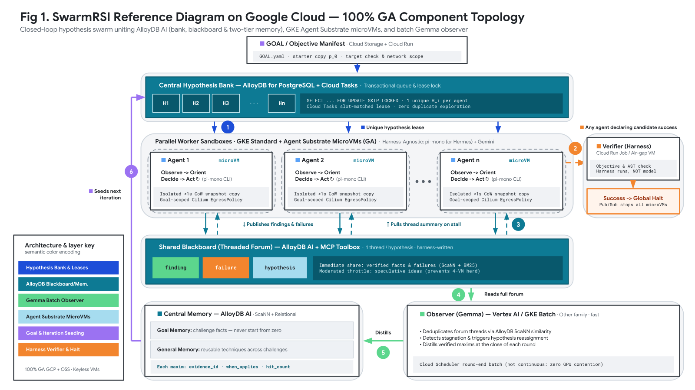
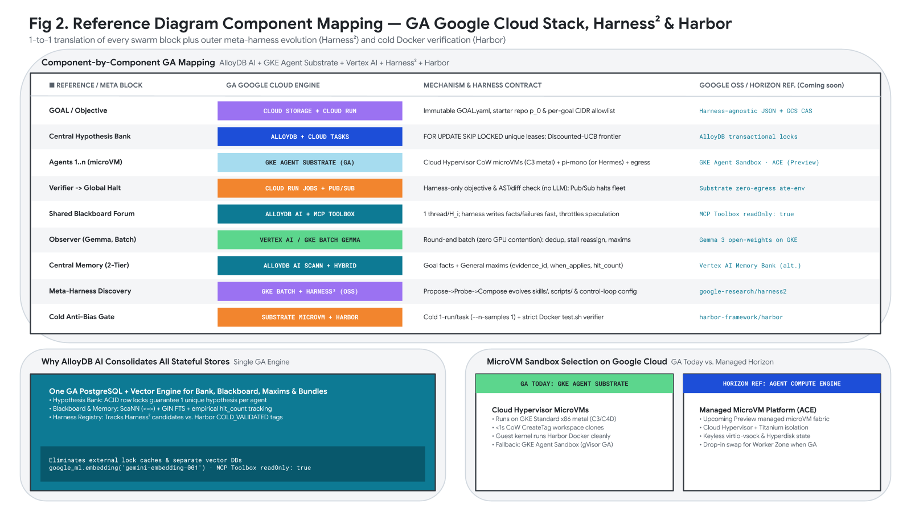
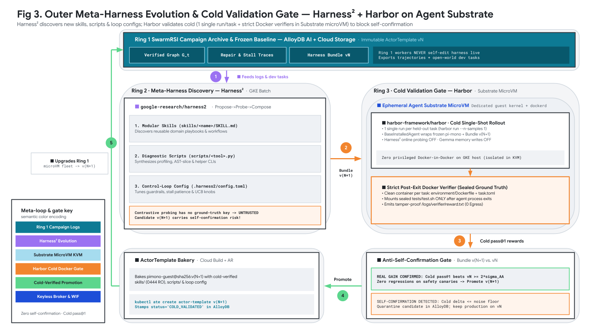

# SwarmRSI + `pi-mono` + `Harness²` + `Harbor` on Google Cloud (GA MVP)

Minimal, production-grounded reference repository implementing the **Three-Ring SwarmRSI Architecture** on **100% Generally Available (GA) Google Cloud services** with harness-agnostic **`pi-mono`** (`@mariozechner/pi-coding-agent`, interchangeable with **`Hermes`**).

> **Full 5-Section Architecture Specification & Implementation BOM:** [`docs/ARCHITECTURE_AND_BOM.md`](docs/ARCHITECTURE_AND_BOM.md)







---

## Three-Ring Architecture Summary

1. **Ring 1 — Online SwarmRSI Evolution (`control_plane/`, `verifier/`, `guest_pimono/`, `sql/`):**
   - **AlloyDB for PostgreSQL 17 + ScaNN** stores the Central Hypothesis Bank (`FOR UPDATE SKIP LOCKED` leases), Threaded Blackboard (`finding`, `failure`, `hypothesis` with anti-convergence moderation), Program Frontier $F_P$, and Two-Tier Central Memory (`Goal` + `General` Maxims ranked by `wilson_lower_bound(hit_count, attempt_count)`).
   - **GKE Standard `1.37+` + Agent Substrate `v1.0.1`** runs keyless `pi-mono` coding workers inside hardware-isolated Cloud Hypervisor **microVMs** (`c3-highcpu-192-metal` autoscaled `0..1`, with a 1-line `enable_baremetal_microvm = false` toggle for instant zero-quota Day-1 boot on Agent Substrate `gVisor`).
   - **Air-Gapped 4-Gate Cascade Verifier** (`Cloud Run Jobs` + `Pub/Sub` `global-halt`) executes Smoke $\to$ AST Delta & Call-Graph Reachability $\to$ Output SHA-256 Shift $\to$ Sealed Multi-Slice Scoring outside the LLM, separating `UNCREDITED_IMPL_BUG` from `FAITHFUL_NO_GAIN` and halting the fleet in `<2 s` on verified success.
   - **Batch `Gemma 3 (27B-IT)` Observer** runs strictly at round boundaries (zero GPU contention) across 3 schema-locked passes.
2. **Ring 2 — Outer Meta-Harness Discovery (`meta_loop/` + [`google-research/harness2`](https://github.com/google-research/harness2)):**
   - Evolves modular `skills/<name>/SKILL.md`, helper `scripts/<tool>.py`, and `.harness2/config.toml` loop parameters into candidate `Harness Bundle v(N+1)` (`PROPOSED_UNTRUSTED`).
3. **Ring 3 — Cold Anti-Self-Confirmation Gate (`meta_loop/` + [`harbor-framework/harbor`](https://github.com/harbor-framework/harbor)):**
   - Wraps frozen `pi-mono` + `Bundle v(N+1)` inside `SwarmPiMonoHarborAgent` and runs **`harbor run --n-samples 1`** (`1` single cold run per task, enforced by `CHECK (harbor_n_samples = 1)` in AlloyDB) with sealed post-exit Docker verifiers (`environment/Dockerfile` + `tests/test.sh` $\to$ `/logs/verifier/reward.txt`) inside an ephemeral **Agent Substrate `microVM`** running guest-kernel `dockerd` (zero `--privileged` Docker-in-Docker on GKE).

---

## 0. Run the Full Showcase & Verification Suite Locally in 5 Seconds (Zero Cloud Credentials Needed)

```bash
# 1. Run all 4-gate sabotage, Discounted-UCB, Crossover, Gemma gate & Cold Harbor unit tests
make test-local

# 2. Run the turnkey 4-slice Graph Signal Denoising SwarmRSI + Crossover + Global Halt showcase
./scripts/03_run_showcase.sh
```

---

## 1. Deploy on Google Cloud in 4 Commands

### Prerequisites
- `gcloud`, `terraform >= 1.6`, `kubectl`, `go >= 1.23` (for `ate-setup`), and `envsubst`.
- For hardware KVM microVMs (`enable_baremetal_microvm = true`): regional quota `C3-CPUS-per-project-region >= 216` in `us-central1` (and a bare-metal pool exemption if `compute.requireShieldedVm` is enforced at your org root).
- **Zero-Quota Instant Boot:** Set `enable_baremetal_microvm = false` in `infra/terraform/terraform.tfvars` to boot immediately on standard GKE VMs using Agent Substrate `ateworker-gvisor`.

```bash
# Step 1: Provision VPC+NAT+PGA, AR Remote Mirrors, UBLA Buckets, AlloyDB PG17, GKE 1.37+, Tasks, Pub/Sub & WIF
cp infra/terraform/terraform.tfvars.example infra/terraform/terraform.tfvars
# Edit project_id in infra/terraform/terraform.tfvars, then:
make tf-init && make tf-apply

# Step 2: Install Agent Substrate v1.0.1, WorkerPools, and Keyless Broker + Orchestrator
make bootstrap-substrate

# Step 3: Build digest-pinned images, upload sealed 4-slice evaluator, and register ActorTemplates
./scripts/02_build_and_seed.sh --all

# Step 4: Run Harness2 -> Cold Harbor (--n-samples 1) promotion gate & close bare-metal window ($0/hr idle)
make run-meta-gate
make window-close
```

---

## Repository Map

| Directory | Contents |
| :--- | :--- |
| `docs/` | Full 5-section architecture & BOM (`ARCHITECTURE_AND_BOM.md`) + `Fig 1`, `Fig 2`, and `Fig 3` diagrams. |
| `infra/terraform/` | Flat Terraform root module (`apis.tf`, `network.tf`, `storage_and_ar.tf`, `alloydb.tf`, `gke_substrate.tf`, `iam_and_messaging.tf`). |
| `sql/` | `001_swarm_schema.sql` (`PG 17` + `alloydb_scann` + `swarm.harness_bundles`) & `mcp_tools.yaml` (`readOnly: true`). |
| `substrate/` | `workerpools.yaml` (`microVM` + `gVisor` + `control-plane`) and `actor-templates.yaml` (`pi-mono` + `harbor-eval-v1`). |
| `control_plane/` | `ucb_scheduler.py`, `blackboard_valve.py`, `gemma_observer.py`, and unified FastAPI `broker_app.py`. |
| `verifier/` | `four_gate_verifier.py` (`Smoke` $\to$ `AST Reachability` $\to$ `SHA-256 Shift` $\to$ `Sealed Slices` + `GLOBAL_HALT`). |
| `guest_pimono/` | `guest-runnerd.mjs` (`:80`, async `202` + `5s` heartbeats + `SIGTERM` guard) & `extensions/swarm-guardrail.ts`. |
| `meta_loop/` | `harness_bundle_v1/` (`skills/`, `scripts/`, `.harness2/config.toml`), `swarm_harbor_agent.py`, & `Dockerfile.harbor_microvm`. |
| `examples/showcase_goal/` | Turnkey 4-slice Python denoising challenge (`GOAL.yaml`, `starter_p0/`, `sealed_eval/`, and `harbor_cold_suite/`). |
| `scripts/` | Bootstrap, image digest pinning, showcase runner, `$0/hr` bare-metal window close, and clean `500 GiB` PD teardown. |
| `tests/` | `test_mvp_end_to_end.py` verifying every gate, scheduler formula, and anti-self-confirmation check offline. |

## License

Apache License 2.0 — see [`LICENSE`](LICENSE).
